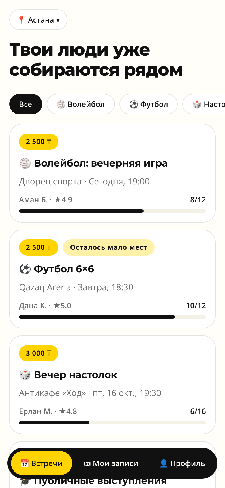
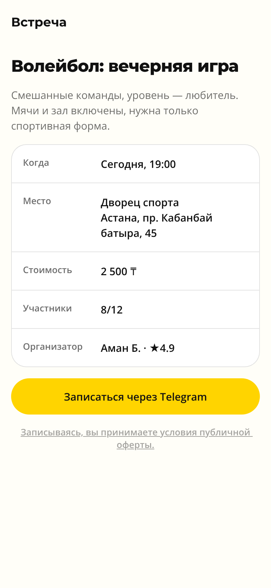
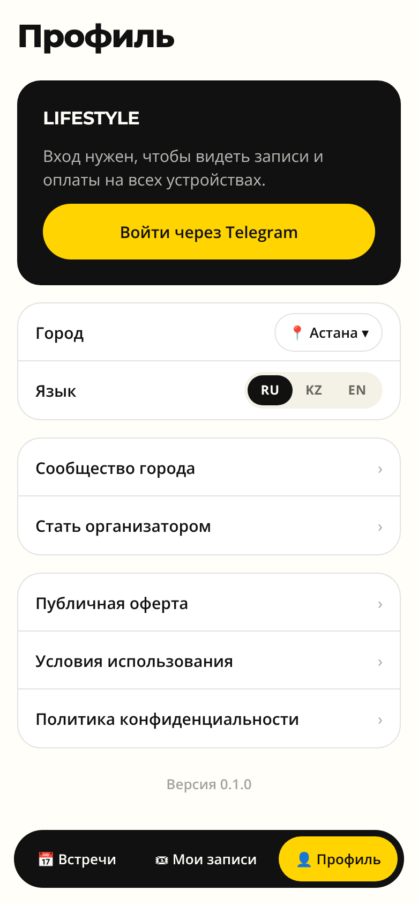
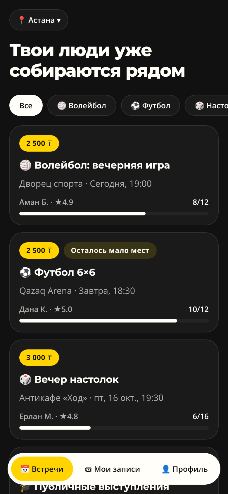

# LIFESTYLE — мобильное приложение (MVP)

Нативный клиент сервиса городских встреч [lifestyle.ink](https://lifestyle.ink) для iOS и Android.
Стек: **Expo SDK 57 · React Native 0.86 · TypeScript · Expo Router**.

| Лента | Встреча | Профиль | Тёмная тема |
|---|---|---|---|
|  |  |  |  |

## Запуск

```bash
npm install
npx expo start          # QR → Expo Go на телефоне; i / a — симулятор
npx expo start --web    # превью в браузере
```

Проверки перед коммитом:

```bash
npx tsc --noEmit
npx expo lint
```

## Структура

```
src/
  app/                  # экраны (Expo Router, файловая маршрутизация)
    _layout.tsx         # шрифты, splash, провайдеры, корневой Stack
    (tabs)/             # таббар: Встречи · Мои записи · Профиль
    event/[id].tsx      # карточка встречи + запись через бота
  api/                  # контракт данных, HTTP-клиент, моки, useQuery
  components/           # доменные компоненты + ui/ (Text, Button, Chip, Screen)
  config/               # города, ссылки, deep-link в бота
  i18n/                 # RU / KZ / EN (структура задаётся ru.ts)
  lib/                  # форматирование ₸ и дат
  state/                # настройки пользователя (AsyncStorage)
  theme/                # дизайн-токены и useTheme()
```

## Дизайн-система

Палитра снята с сайта, токены — в `src/theme/tokens.ts`:

| Токен | Светлая | Тёмная |
|---|---|---|
| background | `#FFFEF8` | `#111111` |
| surface | `#FFFFFF` | `#1A1A1A` |
| text | `#111111` | `#FFFEF8` |
| accent | `#FFD400` | `#FFD400` |
| accentSoft | `#FFF1A8` | `rgba(255,212,0,.14)` |

Шрифты: **Montserrat** (заголовки, замена коммерческого Intro) и **Open Sans** (текст). Оба покрывают казахский алфавит.
Скругления: кнопки и чипы — «пилюли», карточки — 22.

## Интеграция с ботом

- Запись на встречу (MVP) — переход в `@LIFESTYLEK_BOT` с `?start=ev_<eventId>`. Бот должен разбирать payload в `/start`.
- Вход — `?start=app_login` (заглушка до Telegram Login на бэкенде).
- Бэкенд подключается через `EXPO_PUBLIC_API_URL` (см. `.env.example`). Ожидаемые эндпоинты:
  `GET /v1/categories`, `GET /v1/events?city=`, `GET /v1/events/:id` — формат в `src/api/types.ts`.

## Дорожная карта

1. API бэкенда бота и отказ от моков.
2. Авторизация: Telegram Login → JWT, профиль и записи с сервера.
3. Оплата Kaspi (deep-link / Kaspi Pay API), статусы оплаты через вебхуки.
4. Push-уведомления (expo-notifications): новые встречи, напоминание за 2 часа.
5. Кабинет организатора: создание встречи, список участников, QR-чек-ин.
6. Сборка и публикация через EAS (`eas build`, `eas submit`), OTA-обновления (`eas update`).
