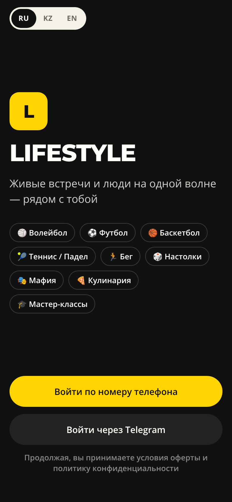
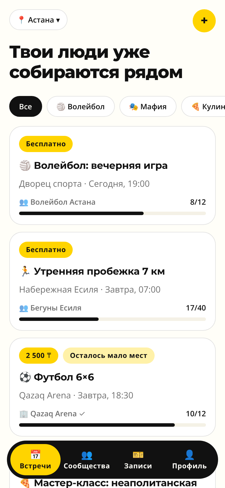
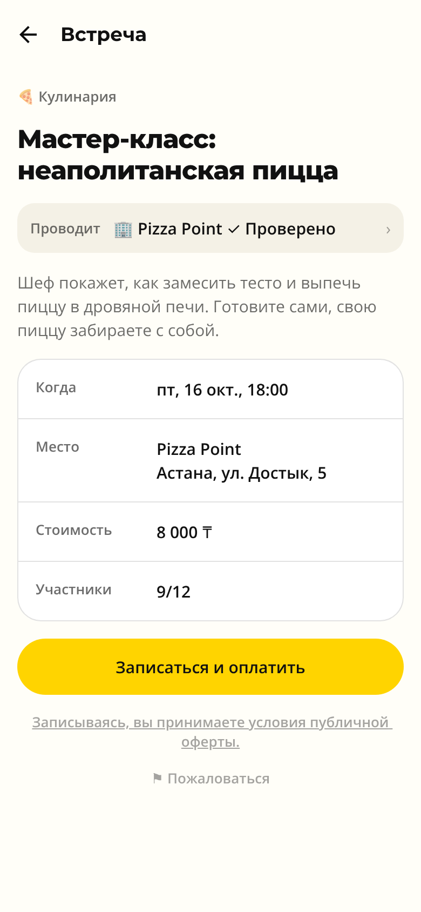
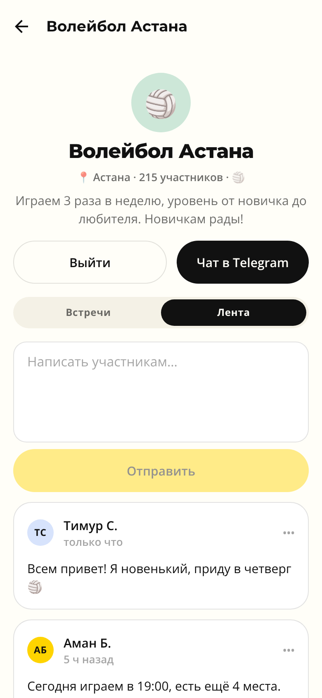
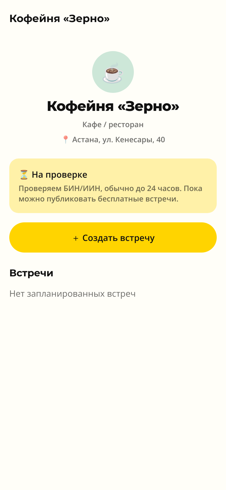
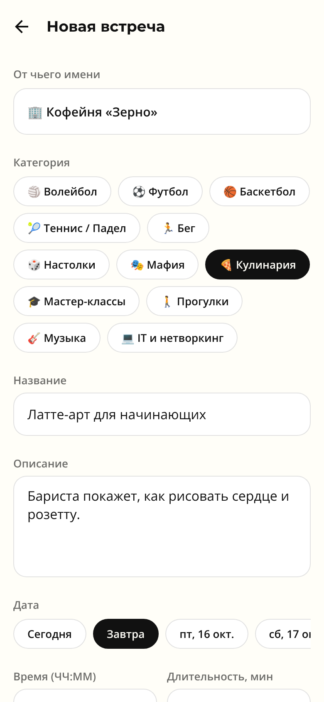
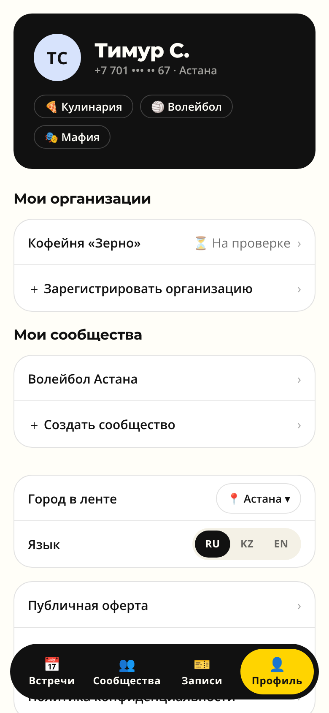
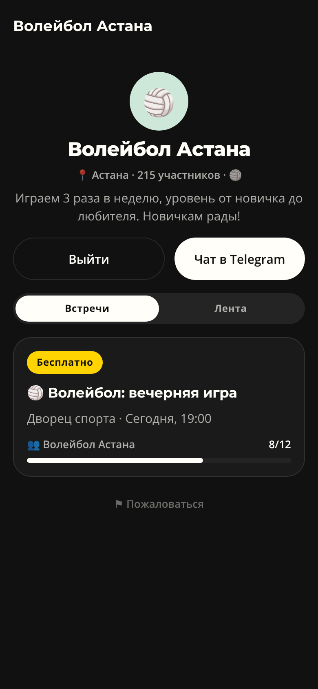

# LIFESTYLE — мобильное приложение (MVP)

Нативный клиент сервиса городских встреч [lifestyle.ink](https://lifestyle.ink) для iOS и Android.
Стек: **Expo SDK 57 · React Native 0.86 · TypeScript · Expo Router**.

Соцсеть живых встреч: пользователи записываются на встречи и вступают в сообщества,
организации (кафе, клубы, спортцентры) и сообщества публикуют встречи. Архитектура и бизнес-правила — [docs/ARCHITECTURE.md](docs/ARCHITECTURE.md).

| Вход | Лента | Встреча | Сообщество |
|---|---|---|---|
|  |  |  |  |

| Организация | Новая встреча | Профиль | Тёмная тема |
|---|---|---|---|
|  |  |  |  |

## Запуск

```bash
npm install
npx expo start          # QR → Expo Go на телефоне; i / a — симулятор
npx expo start --web    # превью в браузере
```

Без `EXPO_PUBLIC_API_URL` приложение работает на тестовом сервере внутри устройства:
вход по любому номеру `+7 7XX XXX XX XX`, **код — 1111**. Данные сохраняются между запусками.

Проверки перед коммитом:

```bash
npm run typecheck
npm run lint
```

## Структура

```
src/
  app/                      # экраны (Expo Router)
    _layout.tsx             # провайдеры, шрифты, Stack.Protected: гость / онбординг / приложение
    (auth)/                 # приветствие, телефон, SMS-код
    onboarding.tsx          # имя, город, интересы
    (tabs)/                 # Встречи · Сообщества · Записи · Профиль
    create.tsx              # «+»: встреча / сообщество / организация
    event/[id].tsx, new.tsx
    community/[id].tsx, new.tsx
    org/[id].tsx, new.tsx
  api/
    types.ts                # доменная модель (контракт с бэкендом)
    api.ts                  # интерфейс Api, ApiError, токен
    http-api.ts             # реализация поверх REST
    mock-api.ts, mock-seed.ts  # тестовый сервер с бизнес-правилами
    queries.ts              # хуки TanStack Query и инвалидация кэша
  auth/                     # сессия, OTP, SecureStore
  components/               # доменные компоненты + ui/
  config/  i18n/  lib/  state/  theme/
```

## Дизайн-система

Палитра снята с сайта, токены — в `src/theme/tokens.ts`:

| Токен | Светлая | Тёмная |
|---|---|---|
| background | `#FFFEF8` | `#111111` |
| surface | `#FFFFFF` | `#1A1A1A` |
| text | `#111111` | `#FFFEF8` |
| accent | `#FFD400` | `#FFD400` |
| accentSoft | `#FFF1A8` | `rgba(255,212,0,.14)` |

Шрифты: **Montserrat** (заголовки, замена коммерческого Intro) и **Open Sans** (текст). Оба покрывают казахский алфавит.
Скругления: кнопки и чипы — «пилюли», карточки — 22.

## Дорожная карта

См. раздел «Дальше» в [docs/ARCHITECTURE.md](docs/ARCHITECTURE.md).
